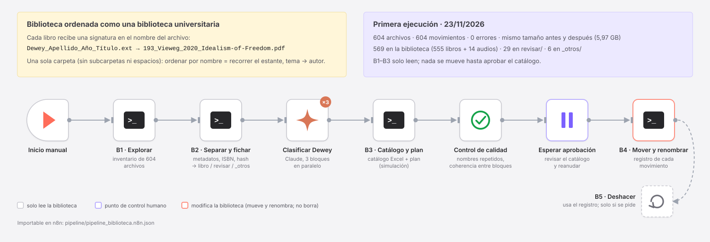

# biblioteca

Ordena una biblioteca de libros digitales (PDF, EPUB, MOBI, DjVu) como lo hace una biblioteca universitaria: **primero por tema y, dentro de cada tema, por autor**. Usa la Clasificación Decimal Dewey y pone una *signatura* en el nombre de cada archivo.



## La idea

En una biblioteca, cada libro tiene una **signatura**: el código del tema (según un sistema de clasificación) más una marca del autor. Como los estantes se ordenan por signatura, los libros quedan agrupados por tema y, dentro de cada tema, por autor.

Este proyecto lleva esa signatura al nombre del archivo:

```
Dewey_Apellido_Año_Título-corto.ext
```

Así, al ordenar la carpeta por nombre, se recorre el «estante»:

```
184_Plato_1997_The-Dialogues-of-Plato-4.pdf
186_Halfwassen_2004_Plotin-und-der-Neuplatonismus.pdf
193_Vieweg_2020_The-Idealism-of-Freedom.pdf
658_Morris_2011_The-Oxford-Handbook-of-Project-Management.pdf
833_Kafka_2009_The-Castle.pdf
863_Borges_sf_El-libro-de-arena.pdf
```

Reglas del nombre:

- **Dewey de 3 cifras.** Son solo números, así que ordenan bien y no traen signos que no sirven en nombres de archivo (la CDU, por ejemplo, usa `:` y `/`).
- **Sin espacios.** El guion bajo `_` separa los campos y el guion `-` reemplaza los espacios dentro del título. Esto facilita la búsqueda.
- **Sin tildes.** `ä→ae`, `ß→ss`, `á→a`, `ñ→n`.
- **`sf` cuando no se conoce el año.**
- **Una sola carpeta, sin subcarpetas**, más `revisar/` (copias idénticas, archivos vacíos o incompletos, basura de Mac) y `_otros/` (lo que no es libro).
- **Los datos completos van en un catálogo en Excel**: título con subtítulo, coautores, editorial, ISBN, idioma y nombre original.

## Pipeline

| N.º | Proceso | Script | Insumo | Método | Resultado | ¿Modifica la biblioteca? |
|---|---|---|---|---|---|---|
| B1 | Explorar | `b1_explorar_biblioteca.py` | Carpeta de la biblioteca | Inventario: tamaño, extensión, patrones de nombre | `datos/inventario_biblioteca.csv` | No |
| B2 | Separar y fichar | `b2_fichas.py` | Inventario | Destino de cada archivo; huella SHA-256 para detectar copias idénticas; metadatos, ISBN y comienzo del texto con PyMuPDF | `datos/fichas.csv` y 3 bloques para clasificar | No |
| B2c | Clasificar | `b2c_clasificar_con_claude.ps1` + `prompts/clasificar_dewey.md` | Bloques | Claude asigna Dewey, apellido, año, título corto y datos de catálogo (3 bloques en paralelo) | `datos/clasificacion/resultado_*.tsv` | No |
| B3 | Catálogo y plan | `b3_catalogo.py` | Fichas y clasificación | Une todo, corrige incoherencias entre bloques, arma nombres sin espacios ni tildes y evita nombres repetidos | `datos/catalogo_biblioteca.xlsx` y `datos/plan_movimientos.csv` | No (simulación) |
| — | Control de calidad | `b3b_control.py`, `b3c_coherencia.py` | Catálogo | Revisa nombres repetidos, una muestra al azar y autores repartidos en varias clases | Informe en pantalla | No |
| — | **Aprobación** | — | Catálogo | Una persona revisa el Excel | Visto bueno | — |
| B4 | Mover y renombrar | `b4_ejecutar.py` | Plan aprobado | Comprueba que todo sea seguro y luego mueve, renombra y anota cada movimiento; no copia ni borra | Biblioteca ordenada y `datos/registro_movimientos.csv` | **Sí** |
| B5 | Deshacer | `b5_deshacer.py` | Registro | Devuelve cada archivo a su nombre y carpeta originales | Biblioteca como estaba | **Sí** (solo si se pide) |

## Cómo usarlo

1. Instala Python 3 y las dependencias:
   ```
   pip install -r requirements.txt
   ```
2. Para el paso de clasificación, instala Claude Code (comando `claude`) e inicia sesión.
3. Indica la carpeta de la biblioteca: edita `RAIZ` en `config.py` o define la variable de entorno `BIBLIOTECA_RAIZ`.
4. Ejecuta los pasos en orden:
   ```
   python b1_explorar_biblioteca.py
   python b2_fichas.py
   powershell -ExecutionPolicy Bypass -File b2c_clasificar_con_claude.ps1
   python b3_catalogo.py
   python b3b_control.py
   python b3c_coherencia.py
   rem  revisar datos\catalogo_biblioteca.xlsx antes de seguir
   python b4_ejecutar.py
   ```
   Para volver todo atrás: `python b5_deshacer.py`.

### Con n8n

`pipeline/pipeline_biblioteca.n8n.json` se importa en n8n (*Import from file*) y reproduce el mismo flujo con nodos *Execute Command*. Ten en cuenta:

- n8n tiene que estar instalado en la misma PC que la biblioteca, y el nodo *Execute Command* debe estar habilitado (en versiones recientes viene desactivado por defecto).
- Los comandos usan las rutas de la PC original. Ajústalas si clonaste el repositorio en otra carpeta.
- El nodo **Esperar aprobación** (*Wait*) detiene el flujo hasta que se llama a su URL de reanudación. Recién entonces corre B4.

## Decisiones de diseño

- **Dewey en lugar de RVK o CDU.** La RVK (la que usan muchas bibliotecas universitarias alemanas) mezcla letras y espacios, y la CDU usa signos. Dewey de 3 cifras da 1000 secciones, suficientes para una biblioteca personal.
- **Nada se borra.** Las copias idénticas (comprobadas con SHA-256, no solo por tamaño), los archivos vacíos, las descargas incompletas y la basura de Mac van a `revisar/`.
- **Los audios que acompañan a un libro** (por ejemplo, un *play-along*) reciben la signatura del libro más el número de pista, para quedar junto a él en el estante.
- **El año no se inventa.** Si no está en el nombre ni en los metadatos, se escribe `sf`. Si la IA lo completó de todos modos, el catálogo lo marca como «estimado».
- **Coherencia entre bloques.** Como la clasificación se hace en bloques paralelos, B3 aplica reglas explícitas para que una misma obra o un mismo tema queden en una sola clase. **Esas reglas (Paso B3.1b) son propias de la colección original y hay que revisarlas para otra biblioteca.**
- **Seguridad.** B1–B3 solo leen. B4 no corre si falta un archivo, si un destino ya existe o si ya hay un registro previo, y comprueba al final que el tamaño total sea el mismo que antes.

## Primera ejecución (23/11/2026)

| | Archivos |
|---|---|
| Total procesado | 604 (6,0 GB) |
| En la biblioteca | 569 (555 libros y 14 audios) |
| En `revisar/` | 29 (20 copias idénticas, 5 de basura de Mac, 2 vacíos, 1 descarga incompleta, 1 zip ya descomprimido) |
| En `_otros/` | 6 |
| Movimientos con error | 0 |
| Clasificaciones con confianza baja | 148 (27 %) |

En esa ejecución, la clasificación la hicieron 3 agentes dentro de una sesión de Claude Code con el prompt de `prompts/clasificar_dewey.md`. `b2c_clasificar_con_claude.ps1` automatiza ese mismo paso con `claude -p`.

## Limitaciones

- **La clase Dewey la asigna una IA, no un catálogo oficial.** Conviene revisar las filas con «Confianza = baja».
- **Con 3 cifras, algunas clases quedan grandes.** Por ejemplo, la 193 (filosofía alemana) tiene 58 libros.
- **El pipeline procesa la biblioteca completa de una vez.** Para los libros que se agreguen después hará falta una versión que procese solo los nuevos.

## Datos y privacidad

La carpeta `datos/` (inventario, fichas, catálogo, plan y registro) **no se sube**, porque contiene el listado personal de libros (ver `.gitignore`). Este repositorio solo tiene el código, el prompt y el pipeline.

## Estructura

```
biblioteca/
├── config.py                       rutas comunes (biblioteca y datos)
├── b0_probar_pymupdf.py            prueba de lectura de PDF/EPUB/MOBI
├── b1_explorar_biblioteca.py       B1 · inventario
├── b2_fichas.py                    B2 · destino, copias idénticas y metadatos
├── b2c_clasificar_con_claude.ps1   B2c · clasificación Dewey con Claude
├── b3_catalogo.py                  B3 · catálogo Excel y plan de movimientos
├── b3b_control.py                  control: repetidos y muestra
├── b3c_coherencia.py               control: autores en varias clases
├── b4_ejecutar.py                  B4 · mover y renombrar (con registro)
├── b5_deshacer.py                  B5 · deshacer
├── prompts/clasificar_dewey.md     instrucciones de clasificación
├── pipeline/
│   ├── pipeline_biblioteca.n8n.json
│   └── pipeline_biblioteca.svg
├── requirements.txt
└── datos/                          (no se sube)
```
